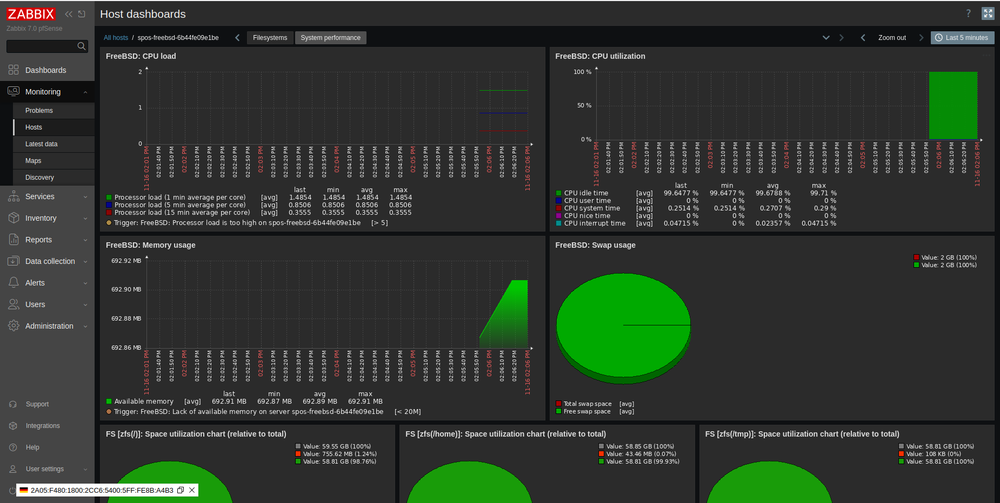

# OSY: automatická registrace FreeBSD do Zabbixu


Tato varianta zadání používá box [bento/freebsd-14.3](https://portal.cloud.hashicorp.com/vagrant/discover/bento/freebsd-14.3) a klasického agenta **Zabbix 8** kompilovaného z portu `net-mgmt/zabbix8-agent`. Vagrant spustí instalační a konfigurační skript automaticky. Agent se připojuje k `enceladus.pfsense.cz` a pro automatickou registraci odesílá `HostMetadata=FBSD`, aby se použilo pravidlo pro FreeBSD.

## Spuštění

```sh
vagrant validate
vagrant up
```

Po změně skriptů lze znovu spustit `vagrant provision`. Jedinečné jméno ve tvaru `spos-freebsd-xxxxxxxxxxxx` se ukládá do `/var/db/zabbix8-agent/spos-hostname` ve VM. Přežije restart i opakovaný provisioning. Při přechodu z agenta 7 se převezme původní uložené jméno. Nová VM vytvořená po `vagrant destroy` dostane nové jméno.

Agent `zabbix8-agent` se instaluje kompilací ze stromu portů, nikoli pomocí `pkg install`. Provisioning nejprve nainstaluje také nástroje `pkgconf`, `muon` a `samurai` a získá strom portů. Potom vytvoří nebo upraví `/etc/make.conf` (ostatní nastavení zachová):

```make
BATCH="yes"
ALLOW_UNSUPPORTED_SYSTEM="YES"
```

V adresáři `/usr/ports/net-mgmt/zabbix8-agent/` spustí `make install package clean`. Tím agenta zkompiluje, nainstaluje, vytvoří balíček a vyčistí pracovní soubory. Případného původního agenta 7 před instalací zastaví a odinstaluje. Již nainstalovaného agenta 8 při opakovaném provisioningu přeskočí.

Instalační skript nástrojů při `pkg update` a instalaci nastavuje `IGNORE_OSVERSION=yes` kvůli dříve zjištěnému rozdílu mezi verzí FreeBSD v boxu a repozitářem balíčků.

## Ověření

Po spuštění VM:

```sh
vagrant ssh
cat /var/db/zabbix8-agent/spos-hostname
pkg info zabbix8-agent
/usr/local/sbin/zabbix_agentd -V
service zabbix_agentd status
grep -E '^(Hostname|Server|ServerActive|HostMetadata)=' /usr/local/etc/zabbix8/zabbix_agentd.conf
getent hosts enceladus.pfsense.cz
nc -z -w 5 enceladus.pfsense.cz 10051
sockstat -4 -l | grep 10050
```

V Zabbixu je registrovaný host `spos-freebsd-6b44fe09e1be` ve skupinách `Customer/SPOS` a `Discovered hosts` se šablonou `FreeBSD by Zabbix agent active`:


Dashboard téhož hosta ukazuje naměřené hodnoty zatížení a využití CPU, paměti, swapu a souborových systémů za posledních pět minut. Tím je doložený příjem dat ze šablony s aktivními kontrolami:



Na snímcích není vidět hodnota přiřazeného štítku; tu lze ověřit na záložce `Tags` v detailu hosta.

## Soubory

- `Vagrantfile`: FreeBSD box a automatický provisioning.
- `install-tools.sh`: instalace balíčků `bash`, `neofetch`, `joe`, `vim`, `htop`, `btop`, `mc`, `nmap`, `git`, `pkgconf`, `muon` a `samurai` před instalací Zabbix agenta.
  Poté stáhne strom portů příkazem `git clone --depth 1 https://git.FreeBSD.org/ports.git /usr/ports`; existující neprázdný adresář při opakovaném provisioningu zachová.
- `install-zabbix8-agent.sh`: nastaví v `/etc/make.conf` hodnoty `BATCH="yes"` a `ALLOW_UNSUPPORTED_SYSTEM="YES"`, poté v `/usr/ports/net-mgmt/zabbix8-agent/` spustí `make install package clean` a ověří verzi 8. Existující instalaci při opakování přeskočí.
- `configure-zabbix8-agent.sh`: stálé jméno hosta, nastavení agenta a spuštění služby.
- `Images/freebsd-zabbix-hero.png`: tematická ilustrace, nikoli důkaz monitorování.
- `Images/FBSD-ZBX8-Agent-reg.png`: dodaný snímek hosta z webového rozhraní Zabbixu.
- `Images/FBSD-ZBX8-Agent-reg-Data.png`: dashboard s naměřenými daty téhož hosta.

## Zdroje

- [FreeBSD port zabbix8-agent](https://www.freshports.org/net-mgmt/zabbix8-agent/)
- [Zabbix 8.0: konfigurace klasického agenta](https://www.zabbix.com/documentation/8.0/en/manual/appendix/config/zabbix_agentd)
- [Zabbix 8.0: automatická registrace](https://www.zabbix.com/documentation/8.0/en/manual/discovery/auto_registration)
